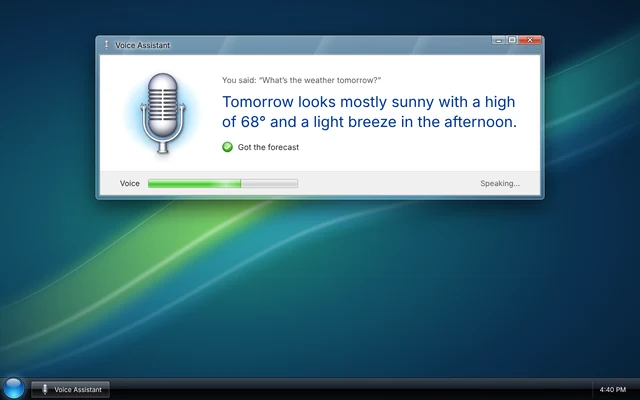

# Vista Voice Skin

A [Kiosk Satellite](https://github.com/jxlarrea/kiosk-satellite) voice skin that draws each voice turn the way Windows Vista would have: an Aero glass window over an aurora wallpaper, a chrome microphone, task dialog text and the green glossy progress bar as the voice meter.



## What it draws

**Full screen.** A glass window titled **Voice Assistant** sits over the wallpaper, with the black glass taskbar and a clock along the bottom. Inside, the microphone glows with your voice and the answer appears in blue, like a Vista task dialog's main instruction. What you said shows above it and the action the assistant took shows below it with a green check. The footer holds the progress bar:

| While | The bar | The microphone |
| --- | --- | --- |
| Listening | Follows your voice | Glow swells with your voice |
| Thinking | A green marquee glides across | Shrinks inside a turning busy ring |
| Speaking | Follows the answer's audio | Glow swells with the answer |
| Done or announcing | Full | Glow breathes |

**Docked.** A small glass window at the bottom of the screen with the microphone, the conversation and a thin progress bar. The dashboard stays in view and usable around it.

**Dark theme.** Smoky black glass with a black glossy client area, in the style of Windows Media Player 11.

## Settings

The skin follows **Voice Satellite > Appearance**:

- **Theme**: Auto, Light or Dark.
- **Background**: the wallpaper's opacity. Skin default is fully opaque.
- **Text size**: scales every line.
- **Reactive activity bar**: while off, the bar and glow stay still.

It also follows the **Show what you said**, **Show the answer** and **Show tool use** conversation settings.

Its own settings, under **Plugin Manager > Vista Voice Skin**:

| Setting | Default | What it does |
| --- | --- | --- |
| Window title | Voice Assistant | The text in the title bar and on the taskbar button |
| Show taskbar | On | The black glass taskbar and clock on the full screen look |

## Privacy

The skin reads the turn's state, voice level and words from Kiosk Satellite only to draw them. It stores nothing and sends nothing anywhere. It declares `overlay`, `host.read`, `voice.skin` and `voice.text`.

## Use it

1. Install the plugin and enable it.
2. Open **Voice Satellite > Appearance > Skin** and pick **Vista Voice Skin**.
3. Press **Preview**, or say the wake word.

Pick another skin to give the turn back to Kiosk Satellite.

## Build

Install Python 3, JDK 17 or newer and an Android SDK with build-tools, then:

```sh
python3 tools/test.py
python3 tools/build.py
```

The build writes `dist/vista-voice-skin-<version>.zip` for **Plugin Manager > Developer Tools > Install from ZIP**. For a normal install, publish a GitHub release: the Release workflow tests, builds and attaches the files Kiosk Satellite verifies.

## Credits

Built on the [Kiosk Satellite plugin SDK](https://github.com/jxlarrea/kiosk-satellite-plugins). Windows and Windows Vista are trademarks of Microsoft. This skin only borrows the look and is not affiliated with Microsoft.

## License

[Apache-2.0](LICENSE). The microphone image in `assets/` is distributed with the plugin; check its own license before publishing.
